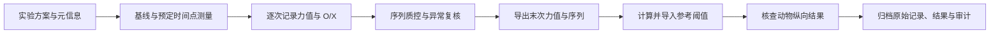

# 小鼠 von Frey 机械痛阈实验流程

[English](README.md) · [简体中文](README.zh-CN.md)

本项目展示小鼠机械敏感性实验从方案准备、逐次 O/X 记录，到质量核查、50% 缩足阈值（PWT）计算和结果归档的完整工作流程。

仓库提供实验流程说明、浏览器录入面板和可复现的**模拟示例**。原始科研项目完整保存在**加密快照**中，真实实验记录与未发表药效结果均在加密归档内。



## 实验主流程

1. **确定实验方案。** 记录动物编号、组别、测试足、纤维丝套件、基线、干预与测量时间点。使用[方案记录表](docs/PROTOCOL_TEMPLATE.md)说明随机化、盲法和获批操作流程。
2. **记录真实观察。** 按预先确定的阳性标准记录：`O` 表示无缩足，`X` 表示阳性反应。同时保留实际起点力值和完整 O/X 序列。
3. **核查数据质量。** 检查编号、时间点、缺失值、起点力值、边界夹紧和操作者备注。修改必须回到原始记录核实，并保留原因。
4. **计算并核对 PWT。** 区分面板本地预览值与导入的网站结果。现有项目流程以外部工具 **Force + Exact** 的结果作为最终报告来源。
5. **归档与统计。** 将原始序列、计算设置、网站原始结果、长表和含审计日志的 JSON 一并保存。重复测量以动物为实验单位，按预定方案统计。

详细操作见[中文实验流程](docs/WORKFLOW.zh-CN.md)，另有[英文版](docs/WORKFLOW.md)。动物操作以本实验获批方案为准；面板默认时间点及示例纤维丝列表属于软件预设。

## 打开录入面板

面板为单文件 HTML，界面为中文，无需构建。在仓库根目录执行：

```bash
python3 -m http.server 8000 --bind 127.0.0.1
```

浏览器打开 <http://127.0.0.1:8000/app/von_frey_entry.html>，点击 **载入模拟 demo**，即可体验数据录入、疑问处理、CSV/JSON 导出与网站结果导入。所有内置数据均为模拟数据，用于演示软件功能，不代表药物效果。

面板通过浏览器 IndexedDB 保存草稿，并以 localStorage 兜底；应定期导出 JSON。展示版使用独立的浏览器存储命名空间，避免自动读取原始实验面板的草稿。

## 复现示例导出

以下命令仅依赖 Python 标准库，可根据 up-down 规则还原力值链，并生成网站输入文件：

```bash
python3 tools/prepare_website_input.py \
  examples/synthetic_sequences.csv \
  --kit standard \
  --output /tmp/von-frey-website-input.csv
```

输出列为 `ID, Final Filament, XO Pattern`，明确区分**起点力值**和**最后一次实际施加的力值**。边界夹紧和全同字符序列会提示复核。此工具不计算药效，也不推断实验结论。

如需运行现有 Python 预览算法，可安装可选分析依赖：

```bash
python3 -m venv .venv
source .venv/bin/activate
python -m pip install -r requirements-analysis.txt
python tools/preview_pwt.py examples/synthetic_sequences.csv --kit standard
```

输出明确标记为 `legacy_preview`，与导入的 Exact δ 阈值分开。计算口径见[算法说明](docs/CALCULATION.md)。

## 仓库结构

```text
app/          录入面板，内置模拟示例
analysis/     现有 probit 预览算法
tools/        序列导出、预览命令行与加密归档恢复工具
examples/     模拟 O/X 数据及预期导出
docs/         流程、方案记录表、算法与数据保护说明
tests/        导出、面板逻辑、隐私与加密检查
private/      原始项目加密快照与密文校验信息
```

加密快照保留原始 Excel、O/X 数据、结果表、脚本、历史导出、研究笔记和参考资料，内含逐文件 SHA-256 清单；排除系统元数据和 Python 缓存。解密方法见[数据保护与恢复](docs/DATA_PROTECTION.md)。密钥由项目所有者单独保管，不进入 Git 仓库。

## 验证

```bash
python3 -m pip install -r requirements.txt
python3 -m unittest discover -s tests -p 'test_*.py' -v
node --test tests/panel.test.cjs
```

检查覆盖力值链重建、起点与末次力值的区别、夹紧识别、模拟 demo 隔离，以及加密归档的完整性保护。软件检查不能代替动物实验验证和统计解释。

## 方法学来源

- Chaplan SR, et al. *Quantitative assessment of tactile allodynia in the rat paw.* Journal of Neuroscience Methods. 1994;53:55–63. [DOI: 10.1016/0165-0270(94)90144-9](https://doi.org/10.1016/0165-0270(94)90144-9)。
- Christensen SL, et al. *Von Frey testing revisited: Provision of an online algorithm for improved accuracy of 50% thresholds.* European Journal of Pain. 2020;24:783–790. [DOI: 10.1002/ejp.1528](https://doi.org/10.1002/ejp.1528)。
- [外部 von Frey 计算器](https://bioapps.shinyapps.io/von_frey_app/)及[上游 R 实现](https://github.com/MikkelAStorm/Up.Down.Method)。

文献用于说明方法来源；大鼠方法需要结合小鼠实验方案适配。[第三方资料说明](THIRD_PARTY_NOTICES.md)列明引用与再分发边界。
